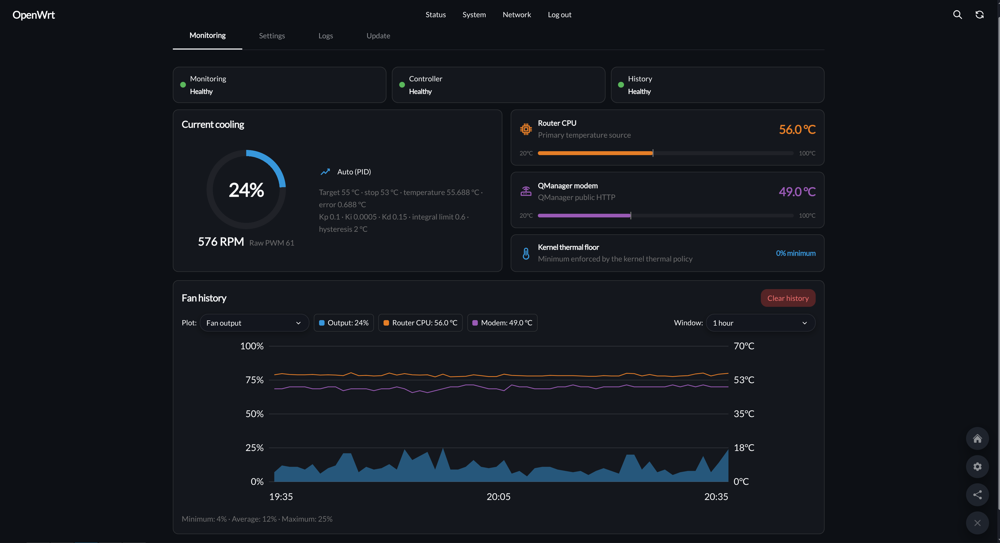
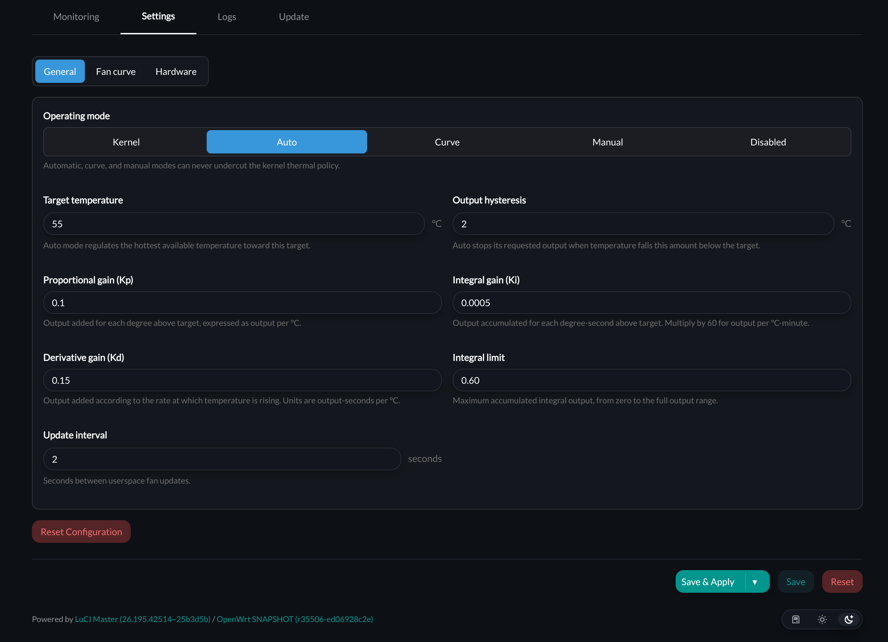
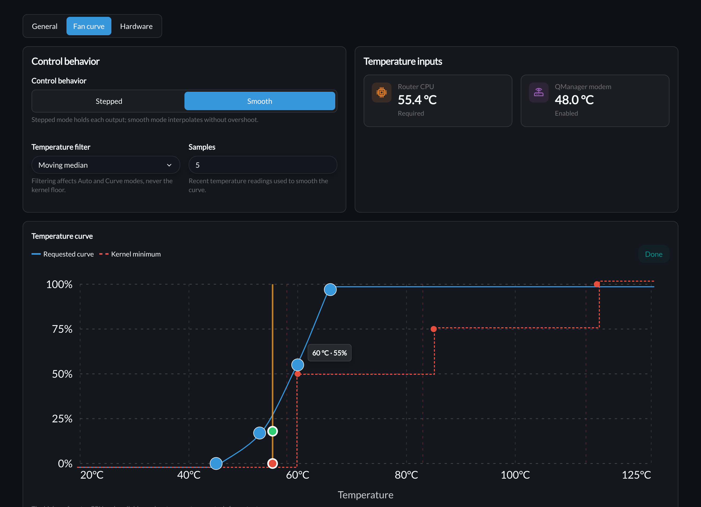

# LuCI PWM Fan Builds

Prebuilt APK packages for PWM fan control on APK-based OpenWrt, with Stable and
Development update channels.

## Gallery

Click a screenshot to open the full image. These screenshots show the Development interface.

| Monitoring and history | General settings | Fan curve |
| --- | --- | --- |
| [](docs/images/monitoring.png) | [](docs/images/settings.png) | [](docs/images/fan-curve.png) |


## What it builds

Each release contains:

- `pwm-fan-control.apk` — controller service and CLI from
  [`MayorBug/packages`](https://github.com/MayorBug/packages/tree/pwm-fan-control/utils/pwm-fan-control)
- `luci-app-pwm-fan.apk` — LuCI interface from
  [`MayorBug/luci`](https://github.com/MayorBug/luci/tree/luci-app-pwm-fan/applications/luci-app-pwm-fan)
- `luci-app-pwm-fan-updater.apk` — Stable/Development updater from this repository
- `sha256sums`, `latest.json`, and `install.sh`

The build records the exact OpenWrt, source, LuCI-feed, and packages-feed commits
in `latest.json`.

- `main` builds Stable releases tagged `vVERSION-rN`.
- `dev` builds Development prereleases tagged `vVERSION-dev-rN`.

## Router support

A router needs all of the following:

- a device-tree `pwm-fan` device
- writable PWM through Linux hwmon
- a readable CPU thermal zone
- a thermal cooling policy connected to the fan

Ascending and electrically inverted monotonic `cooling-levels` are supported.
If hardware is found but its policy cannot be normalized safely, the kernel
keeps fan control while the application provides read-only monitoring. Version
1.1 can also use an optional MediaTek Wi-Fi hwmon temperature in Auto and Curve.
Controller, LuCI, and updater packages are released and installed as one matched set.

**Tested:**

- WS1610
- H5000M
- GL.iNet Beryl 7 (`GL-MT3600BE`)
- Banana Pi BPI-R3

**Candidates awaiting device validation:**

- GL-MT3000
- GL-X3000 / GL-XE3000 family
- GL-AXT1800
- AirPi AP3000M
- CF-WR632AX
- Huasifei WH3000 Pro
- Arcadyan Mozart
- SmartRG family

A fan connector alone does not guarantee compatibility.

## Installation

Connect to your router through SSH as `root`. Run these commands on the router, not on your computer.

Download the Stable installer:

```sh
wget -T 30 -O /tmp/pwm-fan-install.sh https://github.com/MayorBug/pwm-fan-builds/releases/latest/download/install.sh
```

If the download succeeds, run the installer:

```sh
test -s /tmp/pwm-fan-install.sh && PWM_FAN_INSTALL_CHANNEL=stable sh /tmp/pwm-fan-install.sh
```

The installer supports APK-based OpenWrt only. It downloads all three packages and compares their SHA-256 checksums before installation.
After installation, reload LuCI and open System → Fan Control.

The Stable link follows GitHub's Latest release selection. Release maintainers must keep Development builds marked as prereleases.
The selected release must contain a Stable manifest for Stable installation.

### Development

Download the Development installer directly:

```sh
wget -T 30 -O /tmp/pwm-fan-install.sh https://github.com/MayorBug/pwm-fan-builds/releases/download/development/install.sh
```

If the download succeeds, select Development explicitly:

```sh
test -s /tmp/pwm-fan-install.sh && PWM_FAN_INSTALL_CHANNEL=development sh /tmp/pwm-fan-install.sh
```

The `development` release contains the installer and manifest after the next Development publication with the updated workflow.
For an older publication without that installer, use `install.sh` from its versioned Development release under [Releases](https://github.com/MayorBug/pwm-fan-builds/releases).

Do not use the Stable installer to select Development. Older Stable installers do not support the channel override.
You can change the channel later from the LuCI Update page.

### If nothing happens

The former `wget -qO- ... | sh` command hides download errors.
If the download fails without producing a script, `sh` receives no commands and exits without installer output.
This symptom does not identify the download failure.

Use the download command above without `-q`. If it fails, copy the complete output when you report the problem.
Do not run the installer after a failed download. A partial file can remain in `/tmp`.

Include the output of these commands in your report:

```sh
cat /etc/openwrt_release
command -v apk
date -u
```
